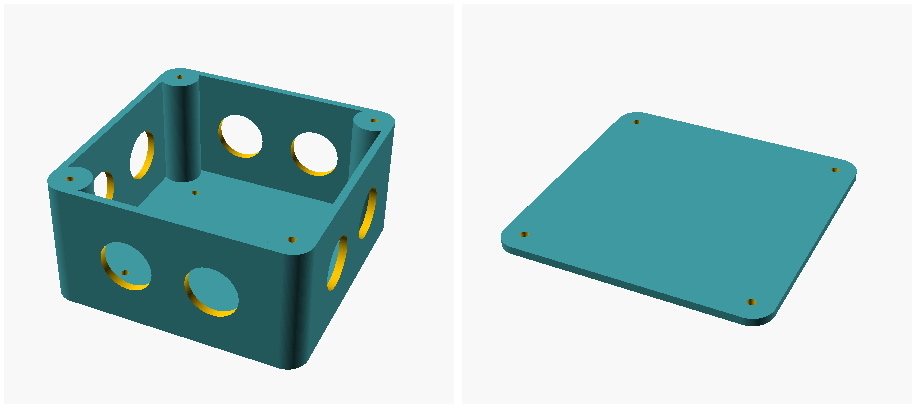

# parametric-junctionbox

A parametric electrical junction box in OpenSCAD: a rounded box with cable-gland
holes in its walls, a screw-down lid, and two accessories, a reducer bushing for
a gland and a blocker for an unused hole. It builds on Adam Oellermann's
[Parametric Electrical Junction Box](https://www.printables.com/model/222985-parametric-electrical-junction-box).

## Use it

Open `junctionbox.scad` in [OpenSCAD](https://openscad.org), edit the
parameters at the top, and set `part`:

| `part` | What it makes |
| --- | --- |
| `"box"` (default) | The box, 100 × 100 × 50 mm by default. |
| `"lid"` | The lid, as thick as the walls, with a screw hole at each corner. |
| `"bushing"` | A slit sleeve that fits in a gland to grip a thinner cable: `bushing_od`, `bushing_id`, `bushing_length`, `bushing_slitangle`. |
| `"blocker"` | A friction-fit plug for a gland hole you don't use. |
| `"none"` | Nothing, for when you `include` this file in another. |

The main parameters:

| Parameter | Default | Description |
| --- | --- | --- |
| `junctionbox_width`, `_height`, `_thickness` | 100, 100, 50 | Outside size in x, y and z, in mm. |
| `junctionbox_skin` | 3 | Wall, floor and lid thickness. |
| `junctionbox_radius` | 8 | Corner radius; the lid-screw pillars are twice this across. |
| `junctionbox_cablediam` | 20.5 | Gland hole diameter, for M20 glands. |
| `nh`, `sh`, `wh`, `eh` | 2 each | Gland holes in the north (+y), south, west (−x) and east walls, spaced evenly. |
| `junctionbox_lidscrewdiam` | 3 | Lid screw holes, for M3 × 12 self-tapping screws. |
| `junctionbox_mountscrewdiam`, `junctionbox_mountoffset` | 3, 20 | Four holes in the floor for fixing the box to a surface, this far in from each edge. |

The box isn't watertight as printed. A bead of silicone on the rim before
fitting the lid may seal it, and the floor's mounting screws would need sealing
washers.

## Changes from the original

- `part` chooses what to render. Before, the file rendered whichever line of
  its main section was uncommented, which as committed was the blocker, not
  the box.
- The east wall's holes follow `eh`. The box line in the old main section
  passed `wh` instead.
- `junctionbox_mountoffset` places the floor holes. It was ignored, and the
  holes were always 20 mm in.
- All four lid-screw pillars start at the floor. Three of them stood 0.05 mm
  below it, so the box was 50.05 mm tall and didn't sit flat.

## Checks

`just test` takes about 1 s on OpenSCAD 2026.10.15. It renders each part and
checks its size, and that it's one piece standing on z = 0. It counts the holes
in each wall with different counts per side, measures the floor holes at two
offsets, and checks that an unknown `part` is refused. `just images` renders
the picture above; it needs ImageMagick's `montage`.

## Licence

Adam Oellermann's original is GPL-3.0-or-later, and so is this; see
[LICENSE](LICENSE).
